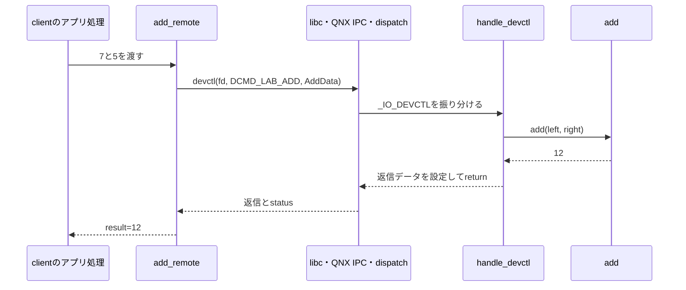

# ステップD：アプリのAPIからOS通信までを追う

確認する問いは次の2つ。

1. `add_remote(7, 5)` は、どこで通信要求になり、どこで足し算処理へ渡るか。
2. リソースマネージャーと、これまでのメッセージ・パルス・共有メモリは、どう使い分けるか。

## 公式の根拠と読む順序

1. QNXの[単一スレッドのリソースマネージャー例](https://www.qnx.com/developers/docs/8.0/com.qnx.doc.neutrino.resmgr/topic/skeleton_SIMPLE_EGS.html)で、初期化・パス登録・dispatchループの骨格を見る。
2. [devctlハンドラーの公式サンプル](https://www.qnx.com/developers/docs/8.0/com.qnx.doc.neutrino.resmgr/topic/messages_Sample_IO_DEVCTL.html)で、コマンド判定・データ取り出し・返信の順を読む。
3. 本実装の`main` → `handle_devctl` → `add`に対応付ける。

公式例の構成を参照し、実験対象を足し算1種類に絞った。
リソースマネージャーはパスを公開するユーザープロセスであり、実デバイスがなくても作れる。
パスとハンドラーの対応は[resmgr_attach](https://www.qnx.com/developers/docs/8.0/com.qnx.doc.neutrino.lib_ref/topic/r/resmgr_attach.html)で登録する。

## 最小実装と予想

`/dev/qnx-ipc-lab-add`を公開し、clientが`open`で接続、`devctl`で7と5を渡す。
serverの受信スレッドは1つ。状態を蓄積せず、各要求を独立して計算する。
`read` / `write`による独自の操作は追加していない。

| ファイル | 読むポイント |
| --- | --- |
| protocol.hpp | パス名、コマンド番号、要求と返信を兼ねるAddData |
| client.cpp | main → run_request → add_remote。アプリの引数からdevctlのデータを作る |
| server.cpp | mainの登録 → serveの待機 → handle_devctlの変換 → addの計算 |
| build.cmd | QNX x86_64 / C++17のserverとclientをビルド |

実測前の予想は次のとおり。

| clientの引数 | 操作 | 期待する結果 |
| --- | --- | --- |
| 省略、またはadd | 正常な足し算要求 | status=EOK、result=12、PASS |
| unknown | 未実装のコマンド番号 | status=ENOTTY、PASS |
| short | 正しいコマンドに4バイトだけ渡す | status=EINVAL、PASS |

異常系のPASSは「想定したエラーを受け取れた」という意味。
エラー時のresultは計算結果として扱わない。errnoの数値は実測ログで確認する。
`open` / `close`は失敗時に`-1`と`errno`を使うが、[devctl](https://www.qnx.com/developers/docs/8.0/com.qnx.doc.neutrino.lib_ref/topic/d/devctl.html)はエラー番号を直接返す。

## ビルドと実行

SDP環境設定済みのWindowsのcmdで、リポジトリ直下から実行する。

```bat
08-resource-manager\build.cmd
scp -r -o MACs=hmac-sha2-256-etm@openssh.com 08-resource-manager/build root@QNX_IP:/tmp/
```

QNX_IPはVMの実際のIPへ置き換える。ビルド成功後に転送する。
これまでと同じ`/tmp/build`へ配置するので、以前の実験のserver/clientは先に終了する。

QNX側の端末1でserverを起動する。同じユーザーで実行すること（デバイスの権限は0600）。
学習用VMではrootで実行する想定。

```sh
/tmp/build/server
```

端末2で順に確認する。

```sh
/tmp/build/client
/tmp/build/client unknown
/tmp/build/client short
ls -l /dev/qnx-ipc-lab-add
```

正常要求ではserverに`handler=devctl ... left=7 right=5 result=12`が出る予想。
異常要求は計算前に拒否するため、この足し算ログは出ない。
`ls`で見えるパスは接続先の名前であり、計算結果を保存したディスク上の通常ファイルではない。
確認後は端末1でCtrl+Cを押してserverを終了する。常駐ループに正常終了コマンドは設けていない。

## これまでの通信との対応



`open`による接続は図の前に行い、`close`は要求終了後に行う。
図のOS欄にはユーザー空間のlibcとdispatchライブラリーもまとめて示している。
ここでのProxy／Stubは関数の役割を表し、CommonAPIの生成コードではない。

| これまでの実装 | 今回の実装で対応する箇所 |
| --- | --- |
| name_attachでサービス名を公開 | resmgr_attachでデバイスパスを公開 |
| name_openでcoidを取得 | openでfdを取得し、接続・OCB管理をライブラリーに任せる |
| MSG_ADDと要求構造体 | _IO_DEVCTL、DCMD_LAB_ADD、AddData |
| clientのMsgSend | libcのdevctlがメッセージ通信へ変換 |
| MsgReceive後の種類判定 | dispatch_block / dispatch_handlerと登録したio_functions.devctl |
| rcvidにMsgReply / MsgError | ハンドラーが返信の指定またはエラー番号を返し、フレームワークが返信 |
| name_close | close。標準のハンドラーが接続・OCBを処理 |

同期呼び出しであるためclientの呼び出し元スレッドは返信を待つ。
ハンドラーの中で長時間処理すれば、06と同様に単一受信スレッドの後続処理は遅れる。
これらは設計上の説明であり、この章では待ち状態の時間測定を追加していない。
標準ハンドラーの役割は[リソースマネージャーライブラリーの説明](https://www.qnx.com/developers/docs/8.0/com.qnx.doc.neutrino.getting_started/topic/s1_resmgr_libisreal.html)を参照。

## IPC方式の比較

各行は、アプリから使うときの役割の比較。リソースマネージャーはQNXメッセージ通信の上にAPIを提供する仕組みなので、別の転送原理としては数えない。

| 方式 | 渡すもの・境界 | 返信・完了の扱い | この学習での使いどころ |
| --- | --- | --- | --- |
| QNXメッセージ | 要求と返信、それぞれにバイト数 | MsgSendは返信を待つ | 計算要求、操作の結果取得 |
| パルス | コードと小さな値 | 返信なし。送信成功と受信処理完了は別 | タイマー、更新完了の通知 |
| 共有メモリ | 同じ領域のデータ | 通知と排他は別途設計 | 大きなデータや頻繁な更新の共有 |
| プロセス間Mutex | ロックの所有状態 | データ転送や完了通知を担わない | 共有データの整合性保護 |
| POSIXメッセージキュー | 境界のあるメッセージをキューへ格納 | sendは業務処理の返信を待たない。満杯なら待つ場合がある | 処理時刻を分けたい要求の蓄積 |
| pipe / FIFO | バイト列。アプリ独自のメッセージ境界はない | 業務処理の返信手順は自作 | ストリームを順に渡す |
| リソースマネージャー | open / read / write / devctl等のAPI | 対応する要求・返信をフレームワークが扱う | パスとfdを入口にするサービス |

根拠：[QNX IPCの全体像](https://www.qnx.com/developers/docs/8.0/com.qnx.doc.neutrino.sys_arch/topic/ipc.html)、[POSIX message queues](https://www.qnx.com/developers/docs/8.0/com.qnx.doc.neutrino.sys_arch/topic/ipc_Message_queues.html)、[Pipes and FIFOs](https://www.qnx.com/developers/docs/8.0/com.qnx.doc.neutrino.sys_arch/topic/ipc_Pipes_FIFOs.html)。
表の使いどころは、この実験での設計上の整理。性能順位を測った結果ではない。

## 業務のProxy／Stubへ対応付ける

CommonAPIはアプリ向けAPIと通信方式ごとのbindingを分け、IDLからProxy／Stub等を生成する。
この構成は[COVESAの公式概要](https://covesa.github.io/capicxx-core-tools/)で確認できる。
今回の実装は、この役割分担を読むための小さな対応例になる。

| 層 | 今回 | 業務コードを追うときの確認対象 |
| --- | --- | --- |
| アプリの契約 | 2つのint32からint64の和を返す | IDL、メソッド、同期／非同期、戻り値 |
| Proxy／要求への変換 | add_remoteとAddData | 生成Proxy、引数のシリアライズ、呼び出しID |
| 通信形式 | _IO_DEVCTLとDCMD_LAB_ADD | 選択したbindingのプロトコル、メソッドID、エラー表現 |
| 転送方式 | fd経由のローカルQNXメッセージ | binding/runtimeが使うソケット等の実際の送受信API |
| OSの実行 | カーネルによる転送・待機・起床 | 待つスレッド、タイムアウト、切断時の振る舞い |
| Stub／受信の変換 | handle_devctl | デコード、検証、業務処理への振り分け |
| 業務処理 | add | 利用者が実装する処理、共有状態、ロック |

CommonAPIという名前だけで、下層がMsgSendであるとは判断できない。
業務環境では選択したbinding、生成コード、runtimeの実装・設定から実際の経路を確認する。
今回の対応は役割の比較であり、CommonAPIからこのデバイスを呼べるようにする実装ではない。

## 実装上の境界と確認状況

- 入力サイズと実際に取得できたバイト数を検証し、int64へ拡張してから足す。
- 受信データは[resmgr_msgread](https://www.qnx.com/developers/docs/8.0/com.qnx.doc.neutrino.lib_ref/topic/r/resmgr_msgread.html)でローカル構造体へ読み、返信はフレームワーク所有の領域へコピーする。
- AddDataは同じQNX x86_64 ABIで共有する。エンディアン変換、バージョン交渉、ネットワーク用シリアライズは追加していない。
- タイムアウト・キャンセル、独自スレッドプール、CommonAPI導入は今回の対象外。
- QNX SDP 8.0でクロスビルド確認済み。`-Wall -Wextra -Wconversion -Wsign-conversion -Wshadow -Wformat=2 -Werror`で警告なし。
- QNX上での正常系・異常系の実行、パス表示・終了時の観察は未実施。上記の結果は予想として残す。

実行後は各モードのclientログとserverログを照合し、どこまで到達したかを説明できれば、この実験の確認になる。
