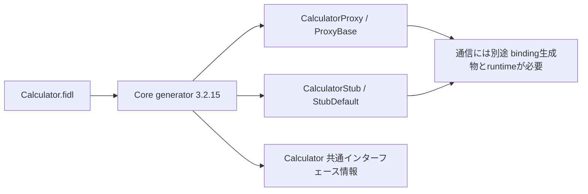

# 同じFIDLをCommonAPI Core generatorに通す

## 問いと流れ

手書きProxy／Stubの役割は本物の生成物のどこに現れるか。



## 読む関数と観察結果

生成物は[generated/](generated/v1/lab/calculator/Calculator.hpp)に分け、手で編集していない。
[生成ファイル一覧](generated-files.txt)は実行時に記録したもの。今回のFIDLは基本型だけなので、独立したTypes.hppは生成されない。

| 手書きで追った役割 | 実際の生成物で読む箇所 |
| --- | --- |
| 契約とバージョン | Calculator.hppのgetInterface、getInterfaceVersion、名前空間v1::lab::calculator |
| Proxyの入口 | CalculatorProxy.hppのadd。int32_tの入力2つ、CallStatusとint64_tの出力 |
| Proxyの転送先 | CalculatorProxy.hppのdelegate_->add、CalculatorProxyBase.hppの仮想add |
| Stubのサービス実装点 | CalculatorStub.hppの仮想addとaddReply_t。返信はint64_tを受けるコールバック |
| 自分で実装する処理 | CalculatorStubDefault.hppのaddを継承先でoverrideし、計算して_reply(result)する |
| MsgSend／MsgReply | Core生成物には存在しない。具体的な転送経路はbinding側が担う |

**生成されたStubDefaultのaddは足し算せず0を返す。** このファイルを書き換えず、アプリ側の派生クラスで実装する。
Coreの生成だけでは、通信も12の計算も実現していない。

## 再生成する順序

2026-11-16にWindows x64、Temurin JRE 8u512-b09で実行。
Coreは`3.2.15.v202410041619`、Francaは`0.13.1.201807231814`。
[公式配布3.2.15](https://github.com/COVESA/capicxx-core-tools/releases/tag/3.2.15)のcommonapi_core_generator.zipを使用。
JREは[Eclipse Adoptium](https://adoptium.net/temurin/releases/?version=8)のWindows x64 JRE 8。
ツール本体・Java・Eclipseの作業領域は追跡しない`build/tools/`へ置く。

展開先はそれぞれ`build/tools/core-3.2.15/`、`build/tools/java8/jdk8u512-b09-jre/`。
別の場所のツールも以下のパラメーターで指定できる。システムへのJavaインストールは不要。

```powershell
.\09-fidl-flow\generate.ps1
# または
.\09-fidl-flow\generate.ps1 -GeneratorPath C:\tools\commonapi-core-generator-windows-x86_64.exe -JavaPath C:\tools\jre8\bin\java.exe
```

内部の生成コマンド（作業ディレクトリは09-fidl-flow）：

```text
commonapi-core-generator-windows-x86_64.exe -vm <java.exe> -data <repo>/build/tools/generator-workspace -d generated -sk Default -pf Calculator.fidl
```

`-sk Default`は観察用のStubDefaultを生成する。`-data`はEclipseメタデータの配置先。
これを省略すると、この環境ではC:\.commonapi-generatorへの書き込みに失敗した。

## 予想と実測ログ

予想：addのint32_t入力2つとint64_tの出力がProxy／Stub双方に現れる。
実際に生成に成功し、上表の宣言と返信コールバックを確認した。
[生成時の実測ログ](generator-run.txt)にはバージョンと出力一覧を保存。
log4jの設定警告は出るが終了コードは0。5ヘッダーを生成した。

取得した配布ファイルのSHA256（再配布元が公開した署名ではなく、今回取得したバイト列の記録）：

```text
commonapi_core_generator.zip
FFE593C94F98078EDCDDCFD322F2CDA34C0433F978C912C8E5DB803A4A118702
java8.zip (Temurin 8u512-b09 Windows x64 JRE)
AE1AE12F817D7735477C6555107EECE73854DA0654DA69077309EF9BFF0B78BF
```

## 分かったことと進捗

Core生成・生成APIの観察は実施済み。CommonAPI runtimeとのコンパイル・CommonAPI通信の実測は実施していない。
手書きQNX教材のビルドは生成物・Java・CommonAPI runtimeに依存しない。
Coreとbindingを分ける構成は[COVESAの公式説明](https://covesa.github.io/capicxx-core-tools/)に対応する。
CommonAPIで12を往復させる実験は計画どおり別枠であり、binding・runtime・QNXへの対応確認を含む。
