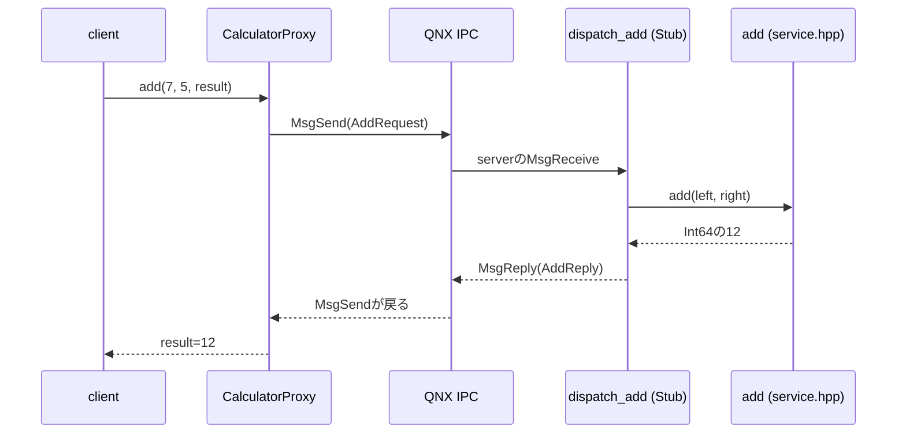

# 09：FIDLの約束から実行まで

## 問い

`add(7, 5)`の引数はどこで要求になり、誰が計算し、どの返信から12を得るか。
契約の原本はFranca IDLの`Calculator.fidl`。入力はInt32が2つ、出力はInt64が1つ、バージョンは1.0。
この章のC++は手書きであり、CommonAPI互換のbindingではない。FIDLを編集しても手書きC++は自動更新されない。

## 流れの図



接続の準備はserverの`name_attach`とclientの`name_open`。FIDL自体は通信しない。
要求は直列に処理し、独自スレッドプール・相関IDは持たない。

## 読む関数

| 順序 | ファイル・関数 | FIDLとの対応・ログ |
| --- | --- | --- |
| 1 | `client.cpp`のmain | `[client]`からProxyのaddを呼ぶ |
| 2 | `proxy.cpp`のCalculatorProxy::add | Int32をAddRequest.left/rightに入れ、`[proxy]`からMsgSend |
| 3 | `server.cpp`のmain | MsgReceiveし、OSメッセージ・パルスとアプリ要求を分ける |
| 4 | `stub.cpp`のdispatch_add | `[stub]`でメソッド番号、元の要求長、受信長、reservedを検証 |
| 5 | `service.hpp`のadd | 通信APIを知らない計算。両引数をInt64に拡張してから加算 |
| 6 | `stub.cpp`のMsgReply | `[service]`の結果をAddReply.resultとして返信 |
| 7 | `proxy.cpp`のMsgSend復帰後 | 結果をC++の出力引数へ取り出す |

`protocol.hpp`は同一QNX ABI向けの構造体。ネットワーク向けのシリアライズ仕様ではない。
clientは接続をname_closeし、serverは受信エラーまたは`once`モードの処理完了後にname_detachする。
常駐モードのserverは実験終了後にCtrl+Cで終了する。

## 起動順

SDP設定済みのWindows cmdから`09-fidl-flow\build.cmd`。
配置の共通手順は[検証手順](../verification/README.md)を参照。章ごとに配置先を分ける。

QNX端末1：

```sh
cd /tmp/qnx-ipc-lab-learning/09-fidl-flow/build
chmod u+x server client
./server
```

QNX端末2：

```sh
cd /tmp/qnx-ipc-lab-learning/09-fidl-flow/build
./client
./client unknown
```

`server once`はアプリ要求を1件処理して終了する検証用モード。接続時のOSメッセージは件数に含めない。
通常実験を説明できたら[本物の生成コードの観察](GENERATED.md)へ進む。

## 予想

通常はclientが12とPASSを表示する。unknownはMsgErrorのENOSYSを受け、想定どおりの拒否ならPASS。
unknownのserverログには`[stub] rejected`があり、`[service]`は出ない。
別プロセスの標準出力の表示順は揺れるので、上の図の因果関係と各ログの対応を見る。

## 実測ログ

2026-11-16、QNX 8.0.0 x86_64で確認済み。
[通常のclient](../verification/2026-11-16/results/09-add-client.txt)、
[通常のserver](../verification/2026-11-16/results/09-add-server.txt)、
[拒否したserver](../verification/2026-11-16/results/09-unknown-server.txt)。

```text
[stub] dispatch add(7, 5)
[service] add result=12
[stub] MsgReply result=12
```

unknownはメソッド番号513、ENOSYSはこの環境で89。エラー判定は数値の直書きではなくENOSYSとの比較で行う。

## 分かったこと

FIDLの引数→Proxyの引数→要求構造体→サービスの引数とたどれる。
契約、変換、通信、計算は別の役割であり、未知の要求は計算前に拒否する。
生成されたAPIでこの役割を探す作業は次の段階。実装・クロスビルド・QNX実測済み。
