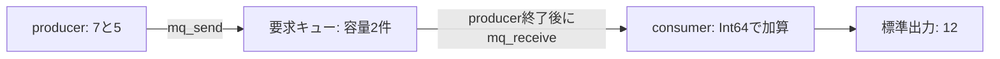

# 10：送信成功と計算完了を分ける

## 問い

producerのmq_sendが成功した時点で、consumerの計算は終わっているか。

## 流れの図



返信キューは作らない。producerには計算結果を受け取る経路がない。

## 読む関数

`protocol.hpp`のAddRequestはInt32の2項。producerのmainはO_CREAT | O_EXCLで専用キューを作り、
同一優先度0でmq_sendしてmq_closeする。既存キューを勝手に開いて実験を混ぜない。
consumerのmainはmq_getattrでmq_msgsizeを検証し、その値以上のバッファでmq_receiveする。
実際の受信長もsizeof(AddRequest)と比較してから読み取る。EINTR時は送受信を再試行する。
通常のconsumerはmq_close / mq_unlinkし、`one-keep`だけは再送実験のため名前を残す。

QNX 8.0では[mq_openの仕様](https://www.qnx.com/developers/docs/8.0/com.qnx.doc.neutrino.lib_ref/topic/m/mq_open.html)どおりlibcにリンクし、追加の-lrtは使わない。
VMで`pidin ar`にmqueueがあることを確認した。停止しているVMでは管理者が`mqueue`を起動する。
キューの性質は[QNXの解説](https://www.qnx.com/developers/docs/8.0/com.qnx.doc.neutrino.sys_arch/topic/ipc_Message_queues.html)も参照。

## 起動順

Windows cmd：`10-posix-mqueue\build.cmd`。章別配置は[共通手順](../verification/README.md)を参照。

QNXでは同一ユーザーで以下を順番に実行する。producer終了後までconsumerを起動しない。

```sh
cd /tmp/qnx-ipc-lab-learning/10-posix-mqueue/build
chmod u+x producer consumer
./producer
./consumer
```

比較実験も同じ端末で順に行う：

```sh
./producer full       # 2件格納し、3件目でEAGAINを確認して終了
./consumer one-keep   # 1件だけ受信し、キューの名前を残す
./producer retry      # 同じキューへ再送
./consumer two        # 残る2件を受信し、close/unlink
```

中断して残った実験専用キューは、他の実験プロセスを止めて`./producer cleanup`で明示的に削除する。
対象は`/qnx-ipc-lab-add-10`だけ。通常系のあとに不要なcleanupは不要。
`retry`とconsumerは存在するキューだけを開き、属性が想定と違えば拒否する。

## 予想

producerだけ実行してもmq_sendは成功し、consumerを後で起動すると12になる。
fullの3件目はO_NONBLOCKによりEAGAIN。one-keepで空きができるとretryが成功する。
consumerはこの教材ではO_NONBLOCKなので、空キューなら待ち続けずEAGAINで失敗する。
fullの途中でconsumerを同時起動すると満杯の前提が崩れるので、必ず上の順に進める。

## 実測ログ

2026-11-16、QNX 8.0.0 x86_64。[全ログ](../verification/2026-11-16/results/10-queue.txt)。

```text
[producer] mq_send accepted #1; calculation not confirmed
[consumer] mq_receive bytes=8 result=12
[producer] third send EAGAIN=1
```

受信後のretry成功と、残る2件それぞれのresult=12も確認した。

## 分かったこと

送信成功はキューへの格納成功であり、計算完了ではない。
「返信を待たない」と「満杯でも待たない」は別。後者はO_NONBLOCKによる選択である。
pipeと違い、キューは送った1件ごとの境界を保持する。プロセスが終了してもunlinkまで名前が残る。
実装・クロスビルド・QNX実測済み。
