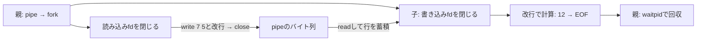

# 11：バイト列から1行を復元する

## 問い

1回writeした要求は、1回のreadで返るか。EOFになる条件は何か。

## 流れの図



## 読む関数

`pipe_demo.cpp`のmainでpipeとfork、不要なfdのclose、親の送信とwaitpidを追う。
`../common/line_stream.hpp`のwrite_allは部分writeとEINTRを処理する。
read_linesは部分readとEINTRを扱い、改行まで蓄積し、readが0ならEOFとして終了する。
calculateは空行・余計なトークン・整数以外・Int32範囲外を拒否し、Int64で計算する。
行長は改行を除き63バイトまで。途中でEOFになった未終端行も拒否する。
SIGPIPEを無視してwriteのEPIPEをエラー処理し、失敗時も親が子を回収する。

QNXの[pipe／FIFOの説明](https://www.qnx.com/developers/docs/8.0/com.qnx.doc.neutrino.sys_arch/topic/ipc_Pipes_FIFOs.html)も参照。
VMの`pidin ar`でpipe managerの稼働を確認した。

## 起動順

Windows cmd：`11-pipe\build.cmd`。章別配置は[共通手順](../verification/README.md)を参照。

```sh
cd /tmp/qnx-ipc-lab-learning/11-pipe/build
chmod u+x pipe_demo
./pipe_demo
./pipe_demo small
```

smallは子の1回のread上限を2バイトにする。書き込み側の要求は同じ`7 5\n`。
拒否の確認用に`invalid`（7 x）、`long`（64桁）、`partial`（改行なし）の引数も用意した。
これらは終了コード1とFAILを返すのが期待値。

## 予想

smallではreadが最低2回必要だが、改行までつなげてresult=12になる。
EOFは「改行を受け取ったとき」ではなく、全書き込みfdが閉じ、残るデータを読み終えたとき。
子にも書き込みfdを残してしまうと、親がcloseしてもEOFを受け取れない。

## 実測ログ

2026-11-16、QNX 8.0.0 x86_64。[smallの全ログ](../verification/2026-11-16/results/11-small.txt)。

```text
[stream] write bytes=4
[stream] read bytes=2
[stream] read bytes=2
[stream] line complete result=12
[stream] read=0 EOF
[parent] child reaped: PASS
```

通常系と、[不正行](../verification/2026-11-16/results/11-invalid.txt)、
[長すぎる行](../verification/2026-11-16/results/11-long.txt)、
[改行前のEOF](../verification/2026-11-16/results/11-partial.txt)の拒否も実測済み。
親子のログはスケジューリングで前後する。

## 分かったこと

pipeは要求の区切りを保持しない。改行はアプリが決めた区切りで、read回数とwrite回数は一致しなくてよい。
forkした子もfdを持つため、双方で不要なfdを閉じることがEOFの成立に必要。
実装・クロスビルド・QNX実測済み。
