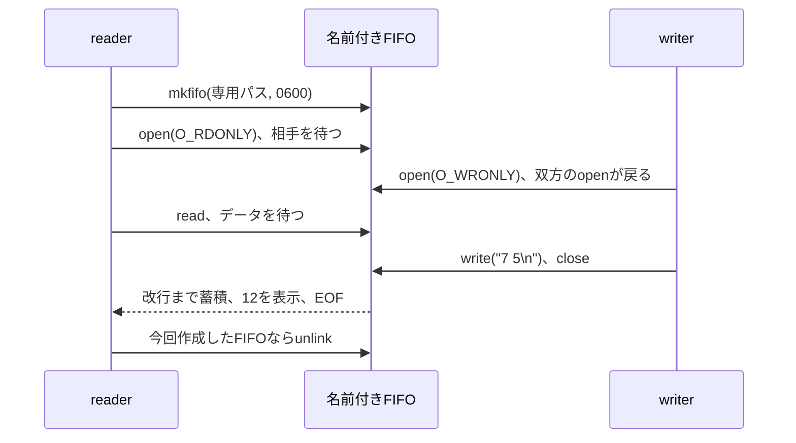

# 12：名前で独立したプロセスをつなぐ

## 問い

親子関係がなくてもpipeと同じバイト列を受け渡せるか。openの待機とreadの待機は何が違うか。

## 流れの図



## 読む関数

readerのmainはmkfifoし、既存パスならlstatで種類を調べる。
fifo.hppのopen_fifoはopen前後をログに出し、既存の通常ファイルやシンボリックリンクを拒否する。
readerは自分が作ったFIFOだけをunlinkする。終了時にデバイス番号・inode・種類も照合し、置換を検出したら消さない。
学習用の単一reader・単一writerの実験であり、同じパスを使う実験を並行実行しない。
writerはwrite_allで送ってcloseする。受信はpipe章と同じ`../common/line_stream.hpp`のread_linesを使う。
部分I/O・EINTR・行長制限・入力検証・Int64加算・EOFの扱いも共通。

[QNXのpipe／FIFO解説](https://www.qnx.com/developers/docs/8.0/com.qnx.doc.neutrino.sys_arch/topic/ipc_Pipes_FIFOs.html)を参照。
このVMではpipe managerが稼働している。専用パスは`/tmp/qnx-ipc-lab-add-12.fifo`、同一ユーザーで実行する。

## 起動順

Windows cmd：`12-fifo\build.cmd`。章別配置は[共通手順](../verification/README.md)を参照。

QNX端末1：

```sh
cd /tmp/qnx-ipc-lab-learning/12-fifo/build
chmod u+x reader writer
./reader
```

QNX端末2：

```sh
cd /tmp/qnx-ipc-lab-learning/12-fifo/build
./writer
```

比較実験では、先に端末1で`./reader --prepare`を1回実行し、FIFOパスだけを作って終了する。
端末2で`./writer`を起動し、before openで止まることを観察する。
その後、端末1で`./reader`を起動すると双方が進む。
パスすら存在しない状態でwriterを実行するとENOENTになるので、準備と接続を分けた。

prepareで作ったFIFOは後のreaderには既存パスのため、自動削除しない。
実験後、全reader／writerを終了し、`ls -l /tmp/qnx-ipc-lab-add-12.fifo`で種類と対象を確認してから
`rm /tmp/qnx-ipc-lab-add-12.fifo`で明示的に片付ける。
通常ファイルなどが存在するときは、この教材から削除・置換しない。

## 予想

通常実験はreaderのopenがwriterを待つ。writer先行実験ではwriterのopenがreaderを待つ。
after openは接続成立、その後のwaiting in readはデータ待ちを示す。
writerがcloseするとreaderは残りを読んでEOFになり、12を表示して終了する。

## 実測ログ

2026-11-16、QNX 8.0.0 x86_64。[通常reader](../verification/2026-11-16/results/12-reader.txt)、
[writer先行](../verification/2026-11-16/results/12-writer-first.txt)、
[後から開いたreader](../verification/2026-11-16/results/12-reader-second.txt)。

writerのbefore openを確認後、1秒経過してもプロセスが存続しafter openが出ないことを確認した。
[待機観察の記録](../verification/2026-11-16/results/12-wait-observed.txt)も保存。
reader起動後に両者が完了し、result=12を得た。通常回はFIFOを自動削除し、prepare回は既存FIFOが残ることも検証した。

## 分かったこと

pipeもFIFOもバイト列で、アプリのメッセージ境界を持たない。
FIFOは名前で独立プロセスをつなぐ。名前が残っていても、通常ファイルのように計算結果が保存されるわけではない。
実装・クロスビルド・QNX実測済み。
