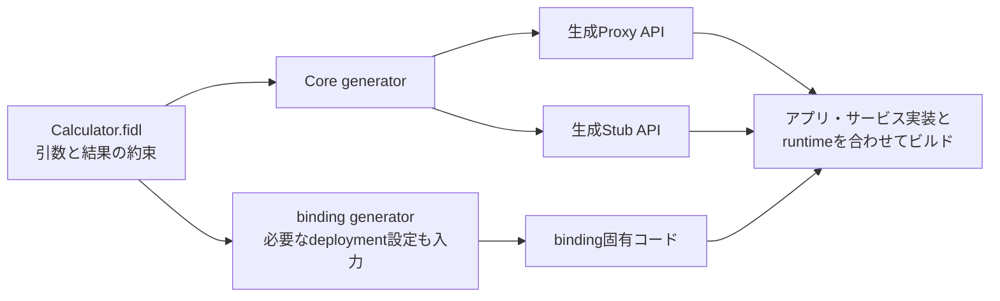
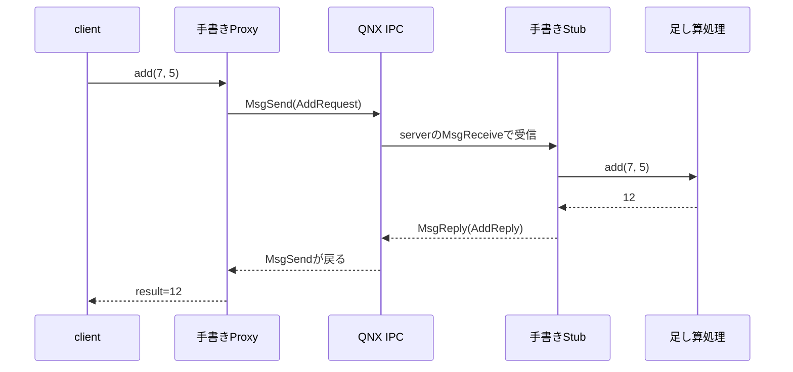

# FIDLとPOSIX IPCを小さく学ぶ実装計画

作成日：2026-11-15。実装・検証記録更新：2026-11-16。
追加教材は全順序分を実装し、QNX向けクロスビルド・QNX VMでの実測を完了した。
CommonAPI Coreの実生成・生成APIの観察も完了。bindingを使う通信は別枠の発展課題として未実施。

| 学習順 | 教材 | 進捗 |
| --- | --- | --- |
| 1 | [09：手書きProxy／Stub](09-fidl-flow/README.md) | 実装済み・クロスビルド済み・QNX実測済み |
| 2 | [09：CommonAPI生成物の観察](09-fidl-flow/GENERATED.md) | ホスト生成済み・生成API観察済み。CommonAPI通信は未実施 |
| 3 | [10：POSIXメッセージキュー](10-posix-mqueue/README.md) | 実装済み・クロスビルド済み・QNX実測済み |
| 4 | [11：pipe](11-pipe/README.md) | 実装済み・クロスビルド済み・QNX実測済み |
| 5 | [12：FIFO](12-fifo/README.md) | 実装済み・クロスビルド済み・QNX実測済み |

全章の再現手順と実測ログは[verification/README.md](verification/README.md)を参照。

目標は、同じ足し算を題材に「APIの約束」「要求・返信への変換」「データの運び方」を順に理解すること。
FIDLは、08で触れたCommonAPIの **Franca IDL** を想定する。
既存の08は参照教材として残し、09以降を独立した小さな教材にする。

## 学ぶ順序

| 順序 | 追加する教材 | 最小の実装 | 理解すること |
| --- | --- | --- | --- |
| 1 | `09-fidl-flow` | FIDL、手書きProxy／Stub、QNXメッセージによる足し算 | 契約から実行までの対応 |
| 2 | 同章の生成コード観察 | 同じFIDLからCommonAPI Coreコードを生成して読む | 自分で書いた役割が生成物のどこにあるか |
| 3 | `10-posix-mqueue` | producerとconsumer、要求キュー1本 | 送信成功と計算完了の違い、メッセージ境界 |
| 4 | `11-pipe` | 親から子へ名前のないpipeで送る | fdの継承、バイト列、EOF |
| 5 | `12-fifo` | 独立起動したwriterとreaderを名前でつなぐ | pipeとの共通点、名前とopenの待機 |

各回は「正常系を1つ動かす → 違いが見える実験を1つ追加 → ログと図を照合」で区切る。
教材は全順序分を用意済み。学習するときは、前の回を説明できたら次へ進む。

## 1. FIDLから足し算までを追う

契約は `add(Int32 left, Int32 right) → Int64 result` の1メソッド。
入力は7と5、結果は12。計算時はint64へ拡張してから足す。
属性・イベント・継承・複数メソッドは追加しない。

### まず、作るときと動くときを分ける

CommonAPIでは、FIDLからAPIのコードを生成し、選んだbinding用の生成コードとruntimeを組み合わせる。
FIDLファイルを要求のたびに送る仕組みではない。[COVESAの公式概要](https://covesa.github.io/capicxx-core-tools/)

作るときの流れ（CommonAPIの構成を示す図）：

最初のQNX実験では、この役割を手書きで追えるようにする。
`Calculator.fidl`は契約の原本とし、その内容を手でC++へ対応付ける。自動生成との接続は次の段階で観察する。

| 予定ファイル | 担当する役割 |
| --- | --- |
| `Calculator.fidl` | addの入力型・出力型・バージョンを定義 |
| `protocol.hpp` | 手書きの要求・返信構造体とメソッド番号 |
| `proxy.hpp` / `proxy.cpp` | addを要求に変換し、MsgSendして返信から結果を取り出す |
| `stub.hpp` / `stub.cpp` | 要求サイズ・種類を検証し、addへ渡してMsgReplyする |
| `service.hpp` | 通信APIを知らない足し算関数 |
| `client.cpp` / `server.cpp` | 接続・受信ループ・終了処理 |
| `build.cmd` / `README.md` | ビルド、実行順序、図とログの対応 |

実行中の流れ（この教材の手書き実装）：

接続は呼び出し前に`name_attach` / `name_open`で準備する。既存01の接続・切断処理を参考にする。
各矢印に対応する関数名をREADMEに書き、client・Proxy・Stub・計算・返信の各地点に短いログを入れる。
要求は同時に1つだけとし、独自スレッドプールや複雑な相関ID管理は入れない。

確認は2つに絞る。

1. 正常要求：上の順で処理が進み、clientが12を得る。
2. 未知のメソッド番号：Stubで拒否され、足し算処理へ到達しない。

完了の目安：FIDLの引数が、C++の引数・要求構造体・サービスの引数へどう対応するか説明できる。
手書き実装はCommonAPI互換のbindingではなく、FIDLを変更してもC++は自動更新されないと明記する。

### 次に、本物の生成物を対応付ける

同じFIDLを実際のCommonAPI Core generatorに通し、生成Proxy・Stub・型定義のaddを探す。
使用するgeneratorのバージョン、実行環境、生成コマンド、生成ファイルの一覧を記録する。
生成物は`generated/`へ分け、手で編集しない。

| 手書きで理解した箇所 | 生成物で探す箇所 |
| --- | --- |
| addの引数と結果 | 生成されたメソッド宣言と型 |
| Proxyの入口 | clientが呼ぶAPI |
| Stubから計算へ渡す箇所 | サービス実装が受け持つメソッドと返信手段 |
| MsgSend／MsgReply | Coreだけでは具体的な転送経路は決まらないことを確認 |

完了の目安：FIDLのaddから生成APIをたどり、自作が必要な処理を指摘できる。
Coreの生成成功と、CommonAPIを使った通信成功は別々に記録する。
generatorの準備に時間がかかる場合も、QNXの手書き実験と後続のPOSIX実験は進められる構成にする。

CommonAPIで実際に通信する発展回は別枠にする。その際は利用環境に合うbindingを1つ選び、
binding用generator・runtime・必要な設定をそろえ、生成Proxyからサービスまで12が往復するところまで確認する。
QNXで使える構成かは導入前に確認する。CommonAPIの下層がMsgSendだとは仮定しない。

## 2. POSIXメッセージキュー：送った後に処理される

予定ファイル：`producer.cpp`、`consumer.cpp`、`protocol.hpp`、`build.cmd`、`README.md`。

`producer → mq_send → 要求キュー → mq_receive → consumerの足し算 → 標準出力`

producerが実験専用キューを作成し、7と5を送って終了する。その後consumerを起動し、1件受信して12を表示する。
最初は返信キューを設けず、送信側が結果を得る仕組みを追加していないことを確認する。
境界のあるメッセージが保持される点は[QNXの説明](https://www.qnx.com/developers/docs/8.0/com.qnx.doc.neutrino.sys_arch/topic/ipc_Message_queues.html)を参照。

追加実験は、容量2件・同一優先度で3件送るものだけにする。
`O_NONBLOCK`で3件目が`EAGAIN`になることを予想し、consumerの受信後に再送できることを見る。
「返信を待たない」と「満杯でも待たない」は別の性質として説明する。

QNXではmessage queue managerが必要。実装時にVM上の稼働状態とリンク条件を確認する。
受信バッファはキューの`mq_msgsize`以上にし、実際の受信長も検証する。
通常終了ではconsumerが`mq_close` / `mq_unlink`を行う。中断時用の明示的なcleanup操作も用意し、残存キューを扱えるようにする。
キューはプロセス終了だけでは消えない。[mq_openの公式仕様](https://www.qnx.com/developers/docs/8.0/com.qnx.doc.neutrino.lib_ref/topic/m/mq_open.html)

完了の目安：producerの送信成功時点では、consumerの計算完了を意味しないとログから説明できる。
返信キューを使う往復実験は、必要になったときの追加課題にする。

## 3. pipe：データはバイト列として流れる

予定ファイル：`pipe_demo.cpp`、`build.cmd`、`README.md`。1つの実行ファイルから親子プロセスを作る。

`親：pipe → fork → write("7 5\n") → close` → `子：read → 改行まで蓄積 → 足し算 → 12を表示`

親は書き込み側、子は読み込み側だけを使い、双方で不要なfdをすぐ閉じる。
部分的なread／writeと`EINTR`を扱い、readが1回で1要求を返す前提を置かない。
入力は短い改行区切りに固定し、行長上限と不正な行の拒否を設ける。

追加実験では、子の1回のreadを2バイトに制限する。
書き込み回数と読み込み回数が一致しなくても、1行を復元して12になることを確認する。
全書き込みfdが閉じられ、残りのデータを読み終えた後の`read == 0`をEOFとして終了する。
プロセス終了は親が`waitpid`で回収する。QNXのpipe managerの稼働も確認する。[QNXのpipe／FIFO解説](https://www.qnx.com/developers/docs/8.0/com.qnx.doc.neutrino.sys_arch/topic/ipc_Pipes_FIFOs.html)

完了の目安：「1回writeすれば1回readで取り出せる」と考えずに、改行が必要な理由とEOFの条件を説明できる。

## 4. FIFO：同じバイト列を名前でつなぐ

予定ファイル：`writer.cpp`、`reader.cpp`、`build.cmd`、`README.md`。

`reader：mkfifo(実験専用パス) → open(O_RDONLY)` ↔ `writer：open(O_WRONLY) → write("7 5\n") → close`

端末を2つ使い、親子関係のないプロセスを接続する。
pipe回と同じ改行形式・読み取り処理を使い、readerが計算結果12を表示する。
readerが今回作成したFIFOだけを終了時にunlinkし、既存パスがあれば種類を確認して勝手に置き換えない。

追加実験ではwriterを先に起動し、相手がいない間はブロッキングopenが待ち、readerが開くと進む様子を見る。
open前後にログを入れ、接続時の待機とreadでのデータ待ちを区別する。
FIFOにもアプリのメッセージ境界はなく、パスに通常ファイルのように結果が保存されるわけではない。[QNXのpipe／FIFO解説](https://www.qnx.com/developers/docs/8.0/com.qnx.doc.neutrino.sys_arch/topic/ipc_Pipes_FIFOs.html)

完了の目安：pipeとの共通点と、名前で独立プロセスを接続する違いを説明できる。

## 各回に残す記録

READMEは「問い → 流れの図 → 読む関数 → 起動順 → 予想 → 実測ログ → 分かったこと」の順にする。
ビルドは既存と同じQNX SDP 8.0・x86_64・C++17を基本とし、各章専用の配置先を使う。
必要なライブラリーとサービスは、対象のQNX 8.0 API仕様とVM構成で確認してから確定する。

進捗は「計画のみ」「実装済み」「クロスビルド済み」「QNX実測済み」を分けて記載する。
実装・検証は09の手書きフロー、生成物の観察、キュー、pipe、FIFOの順序を教材として分離した。
